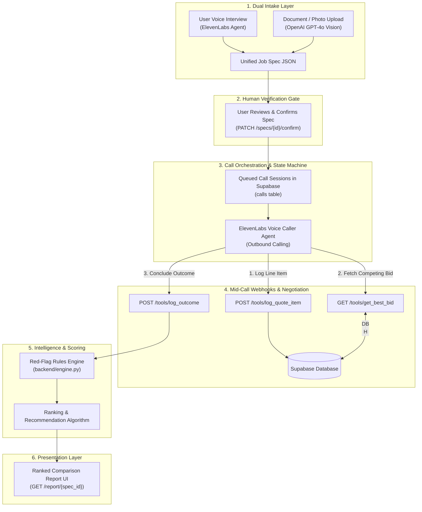
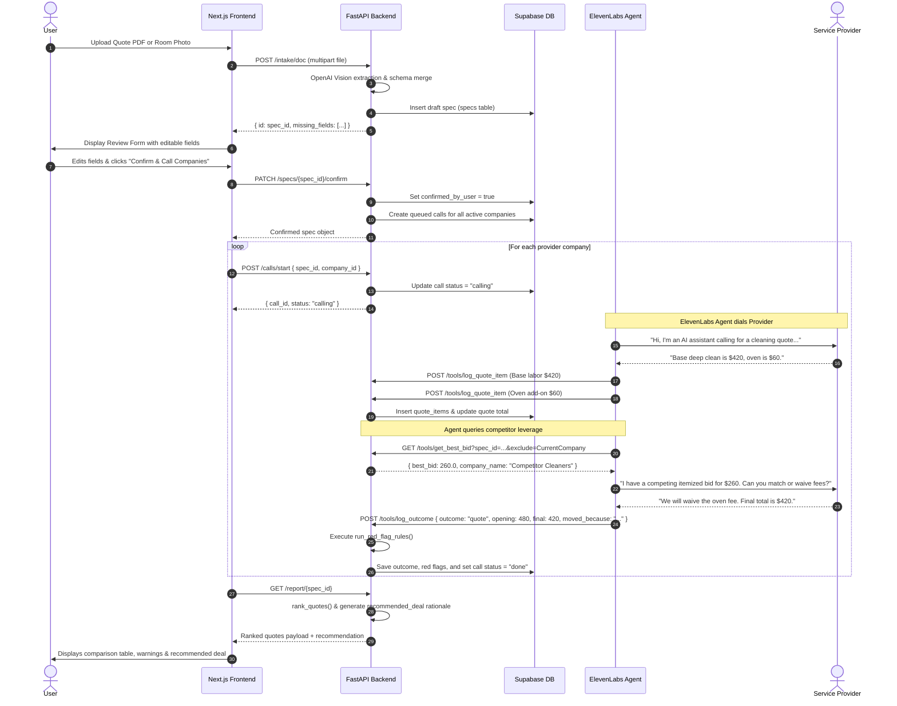

# The Negotiator — Project Overview & Technical Architecture

## 1. Executive Summary

**The Negotiator** is an autonomous voice-agent platform developed for the **ElevenLabs Challenge at the Hack-Nation 6th Global AI Hackathon**.

The application eliminates the friction, hidden fees, and high price variance common in service industries (e.g., home cleaning, moving, auto repair). It operates by:
1. **Capturing a job specification** via dual intake paths (conversational voice interview or document/photo upload).
2. **Enforcing human confirmation** at a strict verification gate before placing phone calls.
3. **Autonomously placing outbound calls** to multiple service providers using ElevenLabs conversational AI agents.
4. **Executing mid-call webhooks/tools** to record itemized line items, query live database leverage (best competing bids), and negotiate price drops honestly without bluffing or hallucinating.
5. **Evaluating red flags** (e.g., deceptive lowballs, refusal to itemize, cash-only demands, uncapped hourly rates) against industry benchmark configurations.
6. **Generating an evidence-backed, ranked comparison report** highlighting the recommended vendor, price concessions achieved, and transcript citations.

The production-shipped vertical is **Home Cleaning** (`verticals/cleaning.yaml`), with **Local Moving** (`verticals/moving.yaml`) demonstrating zero-code vertical swapping.

---

## 2. Technologies Used

### Backend & Orchestration
| Technology | Role & Purpose |
|---|---|
| **Python 3.10+** | Core backend language |
| **FastAPI** | High-performance asynchronous REST API framework handling specs, calls, webhooks, and reports |
| **Uvicorn** | Production-ready ASGI web server |
| **Pydantic v2** | Data validation and schema enforcement for API requests and database boundaries |
| **PyYAML** | Dynamic ingestion of vertical benchmarks, questions, and negotiation rules |
| **HTTPX / Requests** | HTTP client utilities for external communications |

### Database & Persistence
| Technology | Role & Purpose |
|---|---|
| **Supabase (PostgreSQL)** | Relational cloud database hosting tables: `specs`, `companies`, `calls`, `quotes`, and `quote_items` |
| **PostgreSQL JSONB** | Flexible persistence for conditions, line items, and dynamic red-flag explanations |

### AI, Voice & Vision
| Technology | Role & Purpose |
|---|---|
| **ElevenLabs Conversational AI** | Ultra-low latency voice agents: `negotiator-interviewer` (intake) and `negotiator-caller` (dialing, negotiation, barge-in support) |
| **OpenAI GPT-4o / GPT-4 Vision** | Multimodal document parsing: extracts structured job specs from room photos or PDF quotes (`backend/intake.py`) |
| **OpenAI GPT-4.1 & GPT-4o-mini** | Powers the text-mode negotiation simulator (`sim/negotiate.py`) and persona roleplay without burning voice credits |

### Frontend & UI
| Technology | Role & Purpose |
|---|---|
| **Next.js 14 (App Router)** | React framework powering SSR, dynamic routing, and landing experiences |
| **React 18 & TypeScript** | Type-safe UI components and interactive forms |
| **Tailwind CSS** | High-contrast design system optimized for live hackathon demos |
| **Framer Motion** | Fluid animations, progress transitions, and state changes |
| **Lucide React** | Clean iconography across dashboards, cards, and reports |

### Tooling & Networking
| Technology | Role & Purpose |
|---|---|
| **Ngrok** | Secure public HTTPS tunneling exposing local FastAPI endpoints to ElevenLabs webhook calls |
| **JSON Schema** | Standardized data contracts (`schemas/job_spec.schema.json`, `schemas/quote.schema.json`) |

---

## 3. High-Level System Architecture



---

## 4. Key Business Processes

### 1. Dual-Path Intake & Schema Unification
- **Document / Photo Intake (`POST /intake/doc`):**
  Accepts PDF, JPG, PNG, or WEBP files. Uses GPT-4o with strict JSON output matching `_SPEC_TEMPLATE`. Automatically flags missing mandatory fields in `open_questions`.
- **Voice Interview (`negotiator-interviewer`):**
  Conducts an interactive, single-question-at-a-time conversation using questions defined in `verticals/cleaning.yaml`.
- **Contract Schema (`schemas/job_spec.schema.json`):**
  Both paths produce the exact same structured object (property dimensions, clean type, clutter level, add-ons, access rules, schedule).

### 2. The Verification Gate ("Human-in-the-Loop")
Calls are **never** placed automatically. The draft spec is reviewed and edited by the user in the UI. When confirmed:
- Calls `PATCH /specs/{id}/confirm`.
- `confirmed_by_user` flips to `True`.
- The backend iterates through all active companies (`companies` table) and initializes call records in `status: "queued"`.

### 3. Outbound Calling & Mid-Call Tool Calls
The caller agent dials provider companies with strict operating principles:
- **AI Disclosure:** Always opens stating it is an AI assistant calling on behalf of a customer. Plainly confirms if asked *"Are you a robot?"*.
- **Itemization on the Fly (`log_quote_item`):**
  As the provider quotes prices, line items are logged in real time (e.g., base labor, oven cleaning, pet fees).
- **Truthful Competitive Leverage (`get_best_bid`):**
  The agent queries the database for the lowest verified competing bid (`exclude_company=<current>`).
  - *Hard Rule:* The agent **never bluffs** or invents prices. It only cites verified database figures.
- **Structured Outcome (`log_outcome`):**
  Every call must end with one of three structured outcomes:
  1. `quote` (with opening and final totals, conditions, and notes).
  2. `callback` (with specific contact person and time window).
  3. `declined` (documented decline reason).

### 4. Red-Flag Evaluation Engine (`backend/engine.py`)
Evaluates completed quotes against rules defined in `verticals/cleaning.yaml`:
- **Lowball Warning:** Total price is `< 70%` of median benchmark (signals risk of on-arrival bait-and-switch).
- **First-Time Standard Clean:** Standard clean selected when home has not been cleaned in `> 4 weeks` (high risk of mandatory deep-clean upgrade).
- **Uncapped Hourly:** Hourly quote with no guaranteed ceiling.
- **Refusal to Itemize:** Quote returned with 0 line-item breakdowns.
- **Cash Only:** Demands for cash payments or refusal to supply written confirmation.

### 5. Quote Ranking & Recommendation Logic
Quotes are sorted according to a strict priority hierarchy:
1. **Outcome Group:** `quote` > `callback` > `declined`.
2. **Red-Flag Status:** Clean quotes placed before flagged quotes (lowballs and deceptive quotes are demoted).
3. **Total Price:** Ascending order (lowest total cost first).
4. **Recommendation Synthesis:** Automatically constructs a plain-English explanation detailing price savings achieved from negotiation and itemization verifications.

---

## 5. End-to-End Execution Order

### A. Runtime Lifecycle (Single Job Execution)



---

### B. Developer Setup & Startup Execution Order

To run the complete system locally, follow this exact sequence:

1. **Environment Configuration:**
   Copy `.env.example` to `.env` in the project root and fill in required secrets:
   ```env
   SUPABASE_URL=https://your-project.supabase.co
   SUPABASE_SERVICE_KEY=your-supabase-service-key
   OPENAI_API_KEY=sk-...
   ELEVENLABS_API_KEY=...
   ```

2. **Database Initialization:**
   Execute `supabase_schema.sql` inside the Supabase SQL Editor. This initializes tables (`specs`, `companies`, `calls`, `quotes`, `quote_items`) and seeds test companies:
   - `Apex Cleaning Co` (Premium / Tough Negotiator)
   - `Budget Cleaners` (Lowballer)
   - `Sparkle & Shine` (Upseller)

3. **Backend Service Launch:**
   ```bash
   # In root directory:
   python -m venv .venv
   .venv/Scripts/activate  # On Windows (.venv/bin/activate on Unix)
   pip install -r backend/requirements.txt
   uvicorn backend.main:app --reload --port 8000
   ```

4. **Public Tunnel Launch (for ElevenLabs Webhooks):**
   ```bash
   ngrok http 8000
   ```

5. **ElevenLabs Agent Tool Wiring:**
   Update the webhook endpoints in ElevenLabs to point to the public Ngrok URL:
   ```bash
   BACKEND_URL=https://<your-ngrok-subdomain>.ngrok-free.dev python elevenlabs/configure_live.py --apply
   ```

6. **Frontend Dashboard Launch:**
   ```bash
   cd frontend/the-negotiator
   npm install
   npm run dev
   ```
   Open `http://localhost:3000` in the browser.

7. **Verification via Simulation:**
   Run the end-to-end integration test without burning voice credits:
   ```bash
   python backend/test_loop.py
   ```
   Or test caller prompt resilience against individual persona cards:
   ```bash
   python sim/negotiate.py personas/tough-negotiator.md
   ```

---

## 6. Directory Structure & Key Files

```
D:\Negotiaoter\
├── backend/
│   ├── database.py         # Supabase client, schema translation (flat vs nested JSON), CRUD helpers
│   ├── engine.py           # Red-flag evaluation rules & quote ranking logic
│   ├── intake.py           # Document/image intake using OpenAI Vision and schema merging
│   ├── main.py             # FastAPI server, endpoints (/specs, /calls, /tools, /report)
│   ├── requirements.txt    # Python backend dependencies
│   └── test_loop.py        # Automated end-to-end test script simulating full lifecycle
│
├── frontend/
│   └── the-negotiator/     # Next.js 14 Web Application
│       ├── app/
│       │   ├── page.tsx          # Landing page with core principles
│       │   ├── upload/page.tsx   # Document dropzone & voice intake trigger
│       │   ├── review/page.tsx   # Human verification gate (spec edit & confirmation)
│       │   ├── negotiation/      # Live call switchboard and status cards
│       │   └── report/page.tsx   # Final ranked comparison report
│       ├── components/           # Reusable UI widgets (cards, quote tables, forms)
│       └── lib/api.ts            # Client API bindings connecting to FastAPI backend
│
├── verticals/
│   ├── cleaning.yaml       # Shipped vertical config (benchmarks, questions, red-flag rules, levers)
│   └── moving.yaml         # Secondary vertical config (proving plug-and-play architecture)
│
├── schemas/
│   ├── job_spec.schema.json # JSON Schema for validated customer job specifications
│   └── quote.schema.json    # JSON Schema for standardized provider quote outcomes
│
├── prompts/
│   ├── interviewer.md      # Intake voice agent prompt
│   └── caller.md           # Outbound caller and negotiation agent prompt
│
├── personas/               # Role-playing cards with hidden floors and concession rules
│   ├── lowballer.md        # Deceptive low pricing with hidden fees
│   ├── tough-negotiator.md # High opening, drops only on verified competing bids
│   ├── upseller.md         # Pushes unwanted add-ons, tests scope defense
│   └── stonewaller.md      # Refuses phone pricing, tests structured callback commitments
│
├── elevenlabs/
│   ├── configure_live.py   # Script updating ElevenLabs agents with live webhook URLs
│   ├── create_agents.py    # Automated agent provisioning script
│   ├── setup.md            # Dashboard configuration guide
│   └── tools.md            # ElevenLabs tool webhook definitions
│
├── sim/
│   ├── negotiate.py        # OpenAI-based text simulation testing caller prompt against personas
│   ├── quotes.json         # Simulated market quotes persisting leverage across runs
│   └── runs/               # Markdown logs of simulated call runs
│
├── evals/
│   └── golden-calls.md     # 10-point test checklist for voice agent behavior verification
│
├── demo/
│   └── script.md           # 3-minute hackathon presentation script & criteria mapping
│
├── docs/
│   └── conversation-requirements.md # Technical documentation on AI ethics, friction, and honesty
│
├── PLAN.md                 # 24-hour hackathon execution blueprint
├── README.md               # Repository orientation and setup guide
└── supabase_schema.sql     # PostgreSQL database schema & company seed data
```

---

## 7. Core Design Rules & Principles

1. **Prompts & Verticals Are Config, Not Code:**
   Agents load system instructions from `prompts/` and pricing logic from `verticals/*.yaml`. Switching from Home Cleaning to Moving requires swapping a YAML configuration without refactoring backend code.
2. **Schemas Are the Absolute Contract:**
   `schemas/job_spec.schema.json` and `schemas/quote.schema.json` govern both intake paths and all outbound call responses.
3. **Strict Honesty Guardrail:**
   The AI agent **never invents scope, property size, or fake competitor bids**. It only cites real prices returned by `get_best_bid`.
4. **Structured Call Closures:**
   No call ends in an ambiguous conversational state. Every call triggers `log_outcome` with `quote`, `callback`, or `declined`.
5. **Credit Discipline & Simulation-First:**
   All negotiation logic, fee extraction patterns, and prompt safety checks are validated using `sim/negotiate.py` before expending live ElevenLabs voice minutes.
